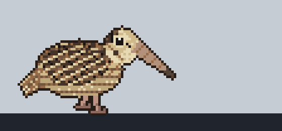

# ヤマシギ・タスクバーウォーカー (Yamashigi Walker)

ヤマシギの親子がタスクバーの上を歩き続ける、Windows 用のデスクトップペットです。



ヤマシギ特有の歩き方「ロッキングウォーク」をドット絵で再現しています。1歩進むたびに、頭は動かさず体だけを前後にゆらします。ときどき地面をつついたり、立ち止まったり、尾を広げたりします。

親ヤマシギの後ろには、より小さな子ヤマシギが寄り添うようにトコトコとついて歩きます。タスクバー全体を気ままに行き来し、ときどき画面外へお散歩に出ては戻ってきます。

## 特徴
- **邪魔にならない**: ウィンドウは透明かつマウス操作が素通り（クリックスルー）するため、作業の邪魔になりません。
- **親子でお散歩**: 親の後ろを一生懸命ついて歩く子ヤマシギ。動きは親と同期してお揃いで揺れます。
- **気ままな行動**: タスクバー全体を横断し、ときどき画面外へ姿を消してはひょっこり戻ってきます。
- **トレイメニュー**: 通知領域（タスクバー右端）のアイコンを右クリックすると、一時停止・大きさ（小/中/大/特大）・速さ（4段階）の変更・終了ができます。

## すぐに遊ぶ (ダウンロード)

ターミナルやコマンド操作は不要です。

1. 本リポジトリの **[Releases](../../releases)**（最新バージョン）を開きます。
2. **`YamashigiWalker.exe`** をダウンロードします（インストール不要の単一ファイルです）。
   - ※ スタートメニュー等に登録したい方向けに、インストーラー版（`YamashigiWalker_Installer.exe`）も用意しています。
3. ダウンロードした **`YamashigiWalker.exe` をダブルクリック**すると、タスクバーの上にヤマシギが現れます。
4. 終了したいときは、画面右下のタスクバー（通知領域）にあるヤマシギのアイコンを右クリックして「**終了**」を選びます。

> [!NOTE]
> **初回起動時の注意**: 開発元が個人による署名なしバイナリのため、Windows SmartScreen の警告（「Windows によって PC が保護されました」）が表示される場合があります。「詳細情報」をクリックし、「実行」を選択してください。

## 開発 (Windows 11)

### 必要な環境
- [Node.js](https://nodejs.org/) 20 以上
- [Rust](https://rustup.rs/)
- WebView2 (Windows 11 には標準搭載)

### コマンド
```powershell
# 依存関係のインストール
npm install

# 単体テストの実行
npm test

# 開発モードで起動 (Tauri)
npm run tauri dev

# 配布用インストーラー/実行ファイルの作成
npm run tauri build
```

ブラウザだけで動きを確認したい場合は `npm run dev` を実行し、表示されたローカルアドレスを開きます（ブラウザ確認時はウィンドウの自動位置合わせやトレイアイコン機能は無効になります）。

## プロジェクト構成

| パス | 内容 |
|---|---|
| `src/brain.ts` | 【頭脳】次に何をするかを決定（歩く・ゆらす・つつく・立ち止まる・向きを変える） |
| `src/actor.ts` | 【身体】時間経過に合わせて座標とコマ（ポーズ）を算出 |
| `src/layout.ts` | 【配置】作業領域（タスクバーを除いた画面領域）の取得と描画スケール計算 |
| `src/settings.ts` | 【設定】大きさ・速さの設定管理と保存 |
| `src/main.ts` | 【描画・統合】Canvas描画ループ、親子ヤマシギの描画、ウィンドウ配置 |
| `src-tauri/` | Windows 側のネイティブシェル（トレイアイコンとメニュー） |
| `art/` | ドット絵生成スクリプト（Python）と素材 |
| `scripts/simulate.ts` | 動きのペースや移動範囲を画面なしで検証するシミュレーター |

ドット絵を作り直したときは、`art/make_sprites.py` を実行し、生成された `art/sprites/woodcock_sheet.png` と `woodcock_sheet.json` を `src/assets/` にコピーしてください。

## 既知の制限
- タスクバーが画面の下にある場合の位置合わせに対応しています（左・右・上にある場合は画面下端を歩きます）。
- メインモニターのみの対応です（マルチモニター対応は今後の課題です）。
- 全画面アプリ（フルスクリーンゲームなど）の上にも表示されることがあります。

## ライセンス
本プロジェクトは [MIT License](LICENSE) のもとで公開されています。
